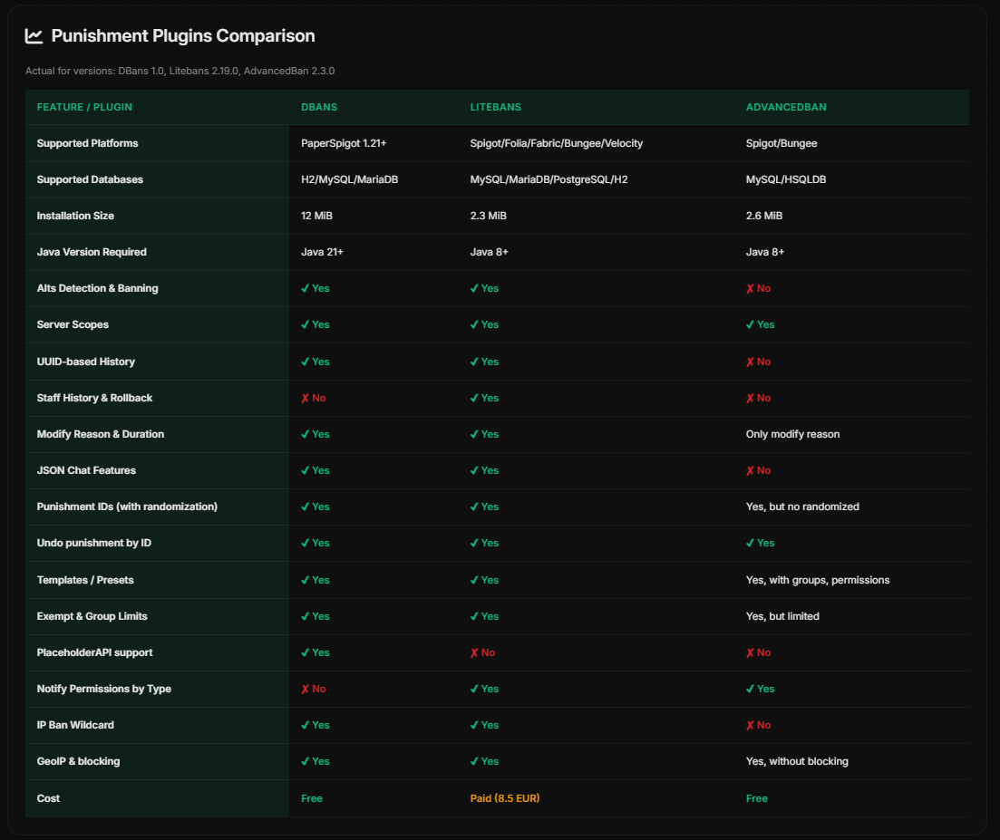

# Comparisons

<figure><figcaption></figcaption></figure>

The comparison table from the [LiteBans wiki](https://gitlab.com/ruany/LiteBans/-/wikis/Comparisons) was used as a basis. In my opinion, it makes no sense to pay 8.5 EUR for functionality that you are unlikely to use someday. In addition, I would like to note that AdvancedBan and DBans are open source, which allows you to quickly solve problems and create a sense of trust among users, while Litebans is closed and your ideas can be rejected.
