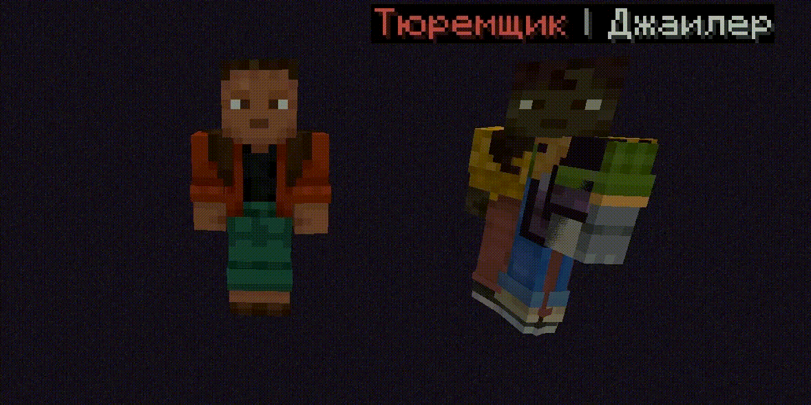

# Jail features

You can put a player in jail for violating the rules of the server, where he will sit alone and will not be able to move or interact with the server community. To use it, use the /jail command (if not specified, then forever) -s server:lobby(optional).

## The mechanics of work

The player enters a separate world where there is only him and the jailer, who writes various phrases, thereby humiliating the player, at this point the player cannot use commands, chat, move, he cannot be teleported out of prison, and it will not be possible to move to the player without special permission (dbans.jail.bypass). At this point, only repentance and humility will save him while waiting for the end of the length of his imprisonment.

## Settings (edited in jail.yml)


You can disable jail (/jail) in the plugin configuration.


There is a jailer (NPC) working in the prison, who works thanks to the Citizens2 or ArmordStand (not tested), you can give him a name and phrases that he will write in the chat and which will be visible only to the player in prison.

You can also set the size of the platform on which the player and the jailer appear after the sentencing.




```yml
platform_size: 10
npc:
  name: "&cJailer &7| &fJDH" ## p.s JDH is a reference to the Russian video blogger Lololoshka
  phrases:
    - "&Sit quietly, violator, and wait for your verdict."
    - "&6 Did you think the rules weren't for you? I made a mistake."
    -"Just one trick— and the sentence will increase!"
    - "Fight, and maybe they'll let you out sooner."
    - "&There is time in prison to think about your behavior."  
  phrase_interval: 5
```




<figure><figcaption><p>An example of how a prison works (/jail)</p></figcaption></figure>

