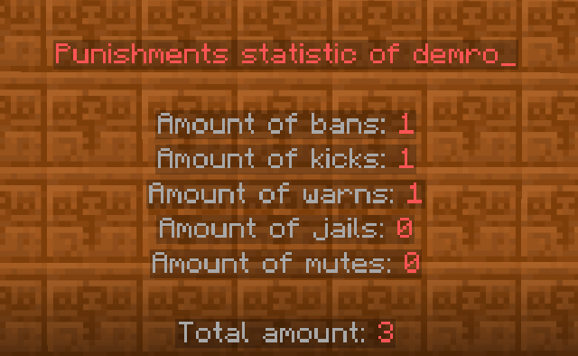
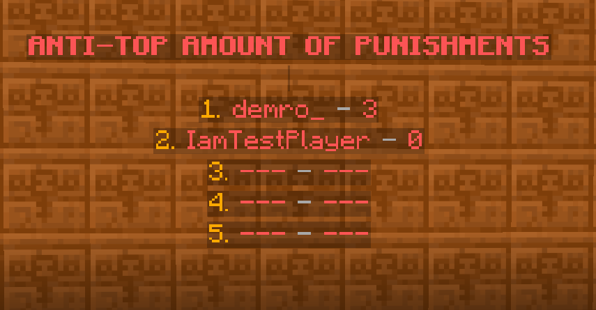
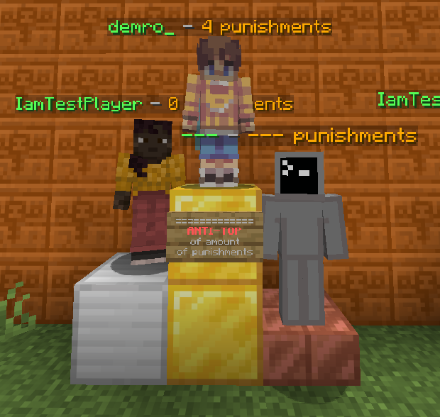
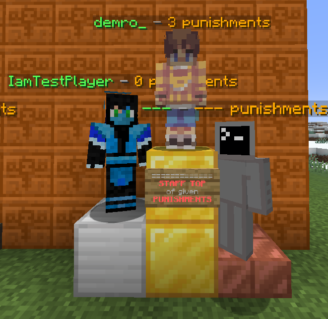

# PlaceholderAPI Integration

## External Placeholders

<table><thead><tr><th width="420" align="center">Placeholder</th><th align="center">Description</th></tr></thead><tbody><tr><td align="center">%dbans_stat_total%</td><td align="center">Allows you to display the amount of penalties for the server, ideal for statistics</td></tr><tr><td align="center">%dbans_stat_total_&#x3C;punishmentType>%</td><td align="center">Allows you to display the amount of specific punishments on the server, ideal for statistics (the type of punishment is indicated in uppercase)</td></tr><tr><td align="center">%dbans_stat_&#x3C;playerName>_total%</td><td align="center">Allows you to display the amount of all punishments for a certain player.</td></tr><tr><td align="center">%dbans_player_total%</td><td align="center">Allows you to display the amount of all punishments for a certain player. (Used to create anti-ratings for players)</td></tr><tr><td align="center">%dbans_stat_player_&#x3C;punishmentType>%</td><td align="center">Allows you to display the amount of a certain punishment received by a player (Used to create anti-ratings of players) &#x26; (the type of punishment is indicated in uppercase)</td></tr><tr><td align="center">%dbans_gives_total_&#x3C;playerName>%</td><td align="center">Allows you to display the total amount of punishments given by a certain player.</td></tr><tr><td align="center">%dbans_gives_total_player%</td><td align="center">Allows you to display the total amount of punishments issued by a certain player (Can be used to create top administrators by the number of punishments issued)</td></tr><tr><td align="center">%dbans_gives_&#x3C;punishmentType>_player%</td><td align="center">Allows you to display the amount of specific punishments issued by a player (Can be used to create top administrators by the number of punishments issued) &#x26; (the type of punishment is indicated in uppercase)</td></tr><tr><td align="center">%dbans_gives_&#x3C;playerName>_&#x3C;punishmentType>%</td><td align="center">Allows you to display the number of specific punishments given by a specific player. (the type of punishment is indicated in uppercase)</td></tr><tr><td align="center">%dbans_stat_&#x3C;playerName>_&#x3C;punishmentType>%</td><td align="center">Allows you to display the number of specific punishments received by the player (the type of punishment is indicated in uppercase)</td></tr></tbody></table>


Important! The type of punishment is indicated in UPPERCASE!


## Types of punishments

* <kbd>BAN</kbd>
* <kbd>MUTE</kbd>
* <kbd>KICK</kbd>
* <kbd>WARNING</kbd>
* <kbd>JAIL</kbd>

## Usage examples

You can create statistics on players and punishments, anti-ratings on players and punishments, ratings of your staff by amount of punishments and type of punishments.

For example i using [ajLeaderboards](https://www.spigotmc.org/resources/ajleaderboards.85548/)



<figure><figcaption></figcaption></figure>



<figure><figcaption></figcaption></figure>



<figure><figcaption></figcaption></figure>



<figure><figcaption></figcaption></figure>



<figure><figcaption></figcaption></figure>


