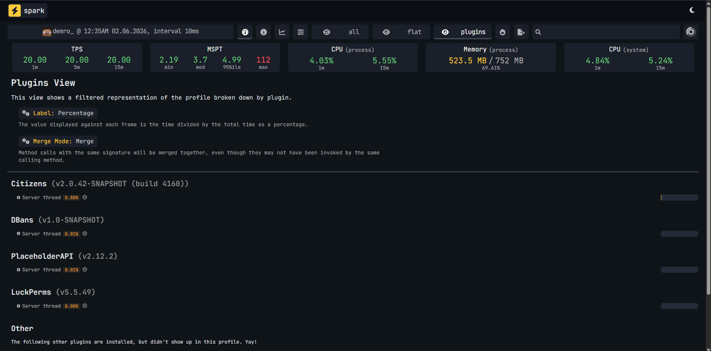

# spark Statistic

<figure><figcaption></figcaption></figure>


From the spark report, you can see that DBans uses less than 0.1% of server threads in idle time, which indicates the high performance of this solution. Most of the load on the threads server is on Citizens2.




* 4x vCPU AMD Ryzen 9 7950X 16-Core Processor
* 16GB DDR4 ECC Memory
* PaperMC 1.21.11-132-c5eb079
* Java 21.0.11
* Debian 11 (bullseye)




```bash
-Xms128M -Xmx3G -XX:+AlwaysPreTouch -XX:+DisableExplicitGC -XX:+ParallelRefProcEnabled -XX:+PerfDisableSharedMem -XX:+UnlockExperimentalVMOptions -XX:+UseG1GC -XX:G1HeapRegionSize=8M -XX:G1HeapWastePercent=5 -XX:G1MaxNewSizePercent=40 -XX:G1MixedGCCountTarget=4 -XX:G1MixedGCLiveThresholdPercent=90 -XX:G1NewSizePercent=30 -XX:G1RSetUpdatingPauseTimePercent=5 -XX:G1ReservePercent=20 -XX:InitiatingHeapOccupancyPercent=15 -XX:MaxGCPauseMillis=200 -XX:MaxTenuringThreshold=1 -XX:SurvivorRatio=32 -Dfile.encoding=UTF-8
```




* Citizens2
* DBans
* LuckPerms
* PlaceholderAPI



